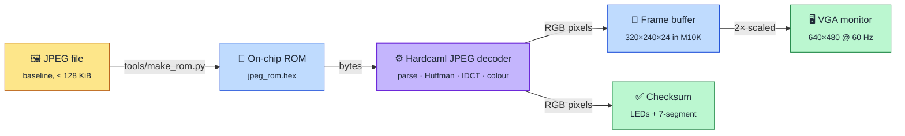
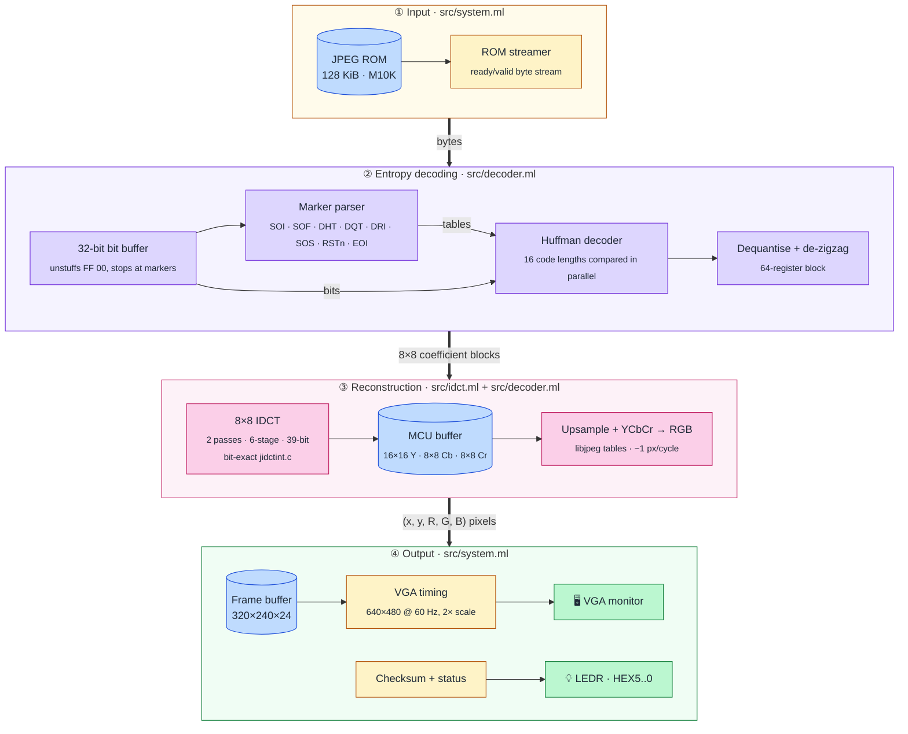
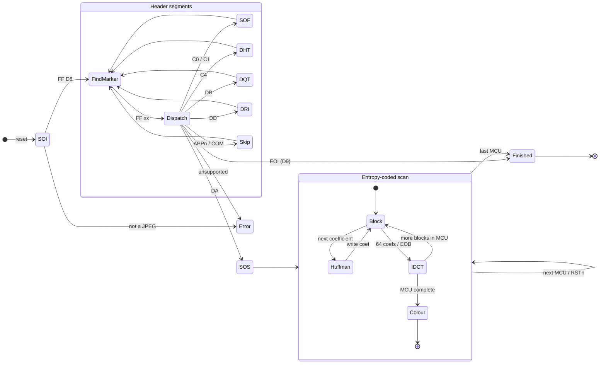
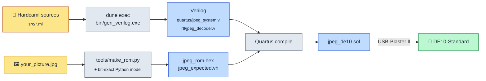

# Hardcaml JPEG decoder for the DE10-Standard (Cyclone V 5CSXFC6D6F31C6)

A baseline JPEG decoder written in [Hardcaml](https://github.com/janestreet/hardcaml)
(OCaml), with a ready-to-compile Quartus project for the **Terasic DE10-Standard** board
(Cyclone V SX `5CSXFC6D6F31C6`). The FPGA decodes a JPEG stored in on-chip ROM, shows it on a
VGA monitor, and checks itself with a checksum shown on the LEDs and 7-segment displays.

You don't need OCaml to run it: the generated Verilog is already in `quartus/`.



---

## 1. Run it on the board (no OCaml needed)

**You need:** Quartus Prime **Lite** 18.1 or newer with *Cyclone V* device support, a
DE10-Standard, its USB-Blaster II cable (the mini-USB "BLASTER" port), and a VGA monitor.

1. Open `quartus/jpeg_de10.qpf` in Quartus and run **Processing → Start Compilation**.
   From a terminal, the same step is:
   ```
   cd quartus
   quartus_sh --flow compile jpeg_de10
   ```
2. Plug the VGA monitor into the board's VGA port and power the board on. Leave the MSEL
   switches (SW10) at their factory setting.
3. Open **Tools → Programmer** and click **Auto Detect**. If Quartus asks which device
   variant to use, pick **5CSXFC6D6**. The JTAG chain contains **two** devices, the ARM HPS
   and the FPGA. Attach `output_files/jpeg_de10.sof` to the **FPGA** (usually the second
   device), tick *Program/Configure*, then click **Start**. From a terminal (run
   `jtagconfig` first to check the device order):
   ```
   quartus_pgm -m jtag -o "p;output_files/jpeg_de10.sof@2"
   ```

### What you should see

* The monitor shows a Mandelbrot picture (the built-in demo JPEG, 320×240, shown 2× at 640×480).
* **LEDR0** (decode finished) and **LEDR1** (checksum matches) are on. **LEDR9** blinks.
* HEX5…HEX0 show **`B93D92`**: the low 24 bits of the checksum of the decoded pixels.
  Push **SW0** up to see the top byte, **`0C`**.
* Press **KEY0** to reset and decode again. The decode takes about 5 ms.

### LEDs, switches, buttons

| Control | Meaning |
|---|---|
| KEY0 | reset and decode again |
| LEDR0 | decode finished |
| LEDR1 | checksum **matches** the expected value (the image is bit-exact) |
| LEDR2 | checksum **mismatch** |
| LEDR3 | decoder error (code on LEDR7..4, see below) |
| LEDR8 | decoder busy |
| LEDR9 | heartbeat (the bitstream is running) |
| all SW down | 7-seg shows checksum bits [23:0] |
| SW0 up | checksum bits [31:24] |
| SW1 up | show the **expected** checksum instead of the computed one |
| SW2 up | image width (HEX5-3) and height (HEX2-0), in hex |
| SW3 up | decode time in microseconds, in hex |

Error codes on LEDR7..4: 1 progressive/arithmetic/lossless JPEG, 2 not 8-bit,
3 not 1 or 3 components, 4 unsupported subsampling, 5 multi-scan file, 6 invalid Huffman
code (corrupt data), 8 bad DHT, 9 bad DQT, 10 bad segment length, 11 height 0 (DNL),
12 not a JPEG (does not start with FF D8).

## 2. Show your own picture

```
python3 tools/make_rom.py my_picture.jpg     # Python 3 only, no extra packages
```

This rewrites `quartus/jpeg_rom.hex` (the ROM contents) and `quartus/jpeg_expected.vh`
(the checksum the hardware must reproduce, computed by a bit-exact Python model). Recompile
in Quartus and program the board again. The script refuses files the hardware can't decode.

The picture must be:
* a **baseline** JPEG (not progressive), 8-bit, colour or greyscale;
* at most **128 KiB**;
* chroma subsampling 4:2:0, 4:2:2, 4:4:0 or 4:4:4 (what normal cameras and editors produce).

Any size up to 65535×65535 decodes, but only the top-left **320×240** pixels fit in the
frame buffer and are displayed. To make a fitting file with ImageMagick:
```
magick photo.jpg -resize 320x240 -interlace none -sampling-factor 4:2:0 -quality 90 small.jpg
```

## 3. What the decoder supports

* SOF0 (baseline) and SOF1 (extended sequential, 8-bit, Huffman), with 8- or 16-bit
  quantisation tables and up to 4 DC + 4 AC Huffman tables.
* Grayscale, or YCbCr with luma sampling 1×1, 2×1, 1×2 or 2×2 (chroma 1×1).
* Restart markers (DRI / RSTn), APPn/COM segments (skipped), EXIF thumbnails, fill bytes.
* Output is **bit-exact with libjpeg-turbo** run as `djpeg -dct int -nosmooth`. That means
  libjpeg's accurate integer IDCT (`jidctint.c`), its YCbCr→RGB tables, and
  replicated ("box") chroma upsampling. Ordinary image viewers smooth the chroma instead,
  so 4:2:0 pictures can differ from them by a few levels on colour edges.

Not supported: progressive JPEG, arithmetic coding, 12-bit, lossless, CMYK/Adobe RGB, and
files that put each component in its own scan.

## 4. How it works

### Data path

Everything runs on the single 50 MHz clock. Bytes flow left to right; the colour stage emits
about one pixel per cycle.



### Control: the decoder state machine

A single state machine in `src/decoder.ml` walks the file's segments, then loops over MCUs
and 8×8 blocks until the scan ends.



### From OCaml to pixels



### The pieces

* `src/decoder.ml`: the decoder core. A single state machine parses the markers and drives
  the entropy decoder. The 32-bit bit buffer refills in the background, removes stuffed
  bytes and stops at markers. The Huffman decoder compares all 16 code lengths in parallel.
  Coefficients are dequantised as they are written into a 64-register block.
* `src/idct.ml`: the 8×8 IDCT, one 8-point 39-bit datapath used for both passes. It is
  exactly libjpeg's `jidctint.c`: pass 2 only needs its sum modulo 2^28, so pass 1 only
  needs modulo 2^39, and the result is still bit-exact.
* `src/system.ml`: the board system: ROM streamer, 320×240×24 frame buffer,
  640×480@60 VGA timing (25 MHz clock enable), checksum, LEDs and 7-segment displays.
  Everything runs on the single 50 MHz clock.
* `quartus/de10_standard_top.v`: maps the generated `jpeg_system` to the board pins and
  adds the power-on/KEY0 reset. `quartus/jpeg_rom.v` holds the JPEG (`$readmemh`).

Checksum: sum over all pixels of `(2·(y·W + x) + 1) · (R | G<<8 | B<<16)` mod 2^32
(`tools/jpeg_ref.py` computes the same value).

Size (Yosys `synth_intel_alm -family cyclonev` estimate for the decoder core alone):
about 8.4K LUTs (roughly 5K of the chip's ~42K ALMs), 10K flip-flops and 29 DSP
multipliers. The board system adds a 1.8 Mbit frame buffer and a 1 Mbit ROM in M10K block
RAM, roughly 350 of the chip's 514 M10K blocks. Quartus's own numbers will differ somewhat.

Speed: about 1 pixel/cycle in the colour stage, and roughly 4–8 cycles per non-zero
coefficient. A 320×240 4:2:0 image takes about 5 ms; a 1680×954 photo takes about 100 ms
(at 50 MHz).

## 5. How it was verified

* **Hardcaml cycle simulation of the core against libjpeg-turbo** (`djpeg -dct int -nosmooth`).
  44 generated test JPEGs covering 4:4:4, 4:2:2, 4:4:0, 4:2:0, greyscale, restart intervals,
  optimised Huffman tables, 16-bit quant tables (SOF1), and odd sizes (17×9, 77×53).
  Each one was run twice, with and without random gaps in the input stream: **88/88
  bit-exact**. Baseline JPEGs from other encoders (500×500 with DRI, 1680×954, 256×256,
  340×200 4:2:0) were also **bit-exact**. Progressive files are rejected with error 1.
* **Python model** `tools/jpeg_ref.py` gives identical output to djpeg on all of them.
* **Whole-system simulation** (`test/sim_system.ml`): ROM → decoder → frame buffer → VGA pins.
  It checks the LEDs, the 800-clock line and 525-line frame timing, and compares all
  307,200 pixels of a captured VGA frame with the reference.
* **The exact Quartus sources** (`de10_standard_top.v` + `jpeg_rom.v` + generated
  `jpeg_system.v` + `jpeg_rom.hex`) were simulated with Icarus Verilog.
* Pin assignments come from the Terasic DE10-Standard user manual, cross-checked against
  Terasic golden-top `.qsf` files.

**Not verified:** this was **not compiled with Quartus** (it was built on a Mac, where
Quartus doesn't run), so the Quartus fit and timing report are untested. The design targets
50 MHz with registered pipeline stages. Check *Timing Analyzer → Slow 1100mV 85C Model →
Fmax* after compiling.

## 6. Rebuilding from the Hardcaml sources (optional)

```
opam install hardcaml ppx_hardcaml ppx_jane      # tested with v0.17
dune build
dune exec bin/gen_verilog.exe -- .               # writes quartus/jpeg_system.v and rtl/jpeg_decoder.v

# core simulation against djpeg (libjpeg-turbo), e.g.
python3 tools/make_test_images.py testdata
djpeg -dct int -nosmooth -pnm -outfile ref.pnm testdata/t_77x53_420.jpg
./_build/default/test/sim_decoder.exe testdata/t_77x53_420.jpg -ref ref.pnm -stall

# whole board: ROM -> decoder -> VGA pins
python3 tools/jpeg_ref.py images/demo_320x240.jpg -o ref.ppm    # prints the checksum
./_build/default/test/sim_system.exe images/demo_320x240.jpg ref.ppm 0CB93D92
```

`rtl/jpeg_decoder.v` is the core on its own, with a ready/valid byte input and an
`(x, y, r, g, b)` pixel output stream, for use in other designs.

### Using a different board

Only `quartus/de10_standard_top.v` and the pin section of `quartus/jpeg_de10.qsf` are
board-specific. The Intel Cyclone V SX SoC Development Kit uses the same chip with a
different pinout. The DE1-SoC and SoCKit use other chips.
